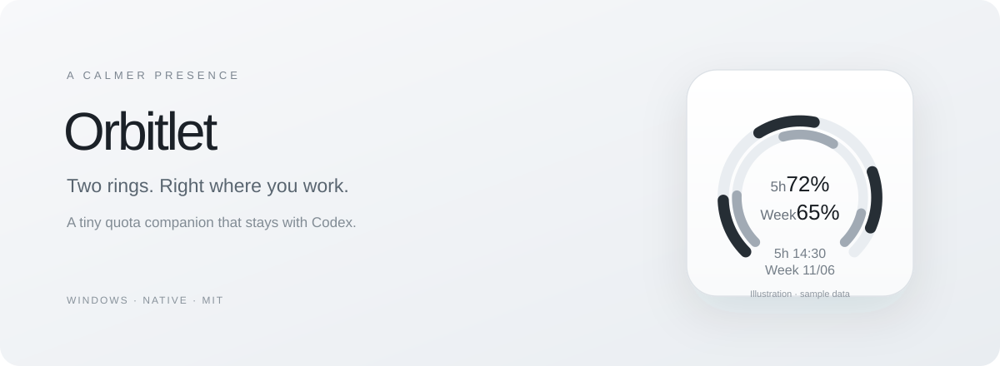

<p align="center"></p>

<p align="center">
  <a href="https://github.com/Chen99999999/codex-orbitlet/releases/latest">Download for Windows</a> ·
  <a href="README.zh-CN.md">简体中文</a> ·
  <a href="https://github.com/Chen99999999/codex-orbitlet/issues">Report an issue</a>
</p>

<p align="center">
  
  
  <a href="https://github.com/Chen99999999/codex-orbitlet/actions/workflows/windows.yml"></a>
</p>

# Orbitlet

Orbitlet is a small Windows companion for AI coding tools. Pick the window it follows and the quota it shows from the tray menu. The two rings display remaining quota where the provider supplies a limit, and the card can show account balances as amounts.

## Made to stay with your editor

- **Window attachment.** The widget follows the position and size of the selected window and hides when you switch away or minimize it.
- **Small by design.** A 136 × 136 px standard view and a 116 × 116 px compact view. A white surface, centered text and two restrained arcs.
- **A quiet little cat.** It jumps onto the progress arc, climbs with traction, slides under gravity, loses contact naturally and lands with spring damping inside the square card. The 28 px cat (24 px compact) also looks around, sits, grooms, stretches and naps. Movement avoids the percentage and end-time text; folding pauses the cat, and reduced motion keeps it still.

- **Quota and balance sources.** Codex, Claude Code, Qoder, GLM Coding Plan, MiniMax, OpenRouter, DeepSeek and Kimi API. See the [setup and compatibility guide](docs/PROVIDERS.md).
- **Honest missing states.** Unknown quota is `--`, not `0%`. A failed refresh retains the last successful values and reset times.
- **Optional automatic start.** A small per-user helper starts Orbitlet when the selected app opens and closes it when that app exits.
- **No inference requests.** Monitoring does not start chats, send prompts or redeem quota resets.

The silver tabby uses twelve AI-generated photographic-style pose frames, not filmed footage or a skeletal animation. The transparent atlas and frame coordinates ship locally in `assets/`; the app does not download pet images while running. The original atlas and generation prompt are kept in `web/assets/` in the source tree.

> Independent community project. Orbitlet is not affiliated with, endorsed by, or an official product of OpenAI. Windows is the supported platform for this release.

## Get started

1. Download the Windows ZIP from [Releases](https://github.com/Chen99999999/codex-orbitlet/releases/latest).
2. Extract the whole archive to a folder you plan to keep.
3. Run `Orbitlet.exe`. The initial window and quota source are Codex.
4. To use another app, right-click the tray icon and choose **跟随窗口** (window) and **额度来源** (source). Follow the [guide](docs/PROVIDERS.md) for any sign-in or API key setup.
5. Optional: run `Enable-Follow.cmd` once to start and stop with the selected app.

The portable app uses Windows .NET Framework. The optional Qoder adapter needs Node.js and its SDK. The binary is currently unsigned.

The attached widget hides when its window is closed, minimized or in the background. For an independent desktop widget, exit the current instance and run `Launch-Standalone.cmd`.

If the CLI cannot be found, set `ORBITLET_CODEX_PATH` to the full path of your installed `codex.exe`. Orbitlet checks the desktop app's known runtime locations and executable entries on PATH; it does not bundle the CLI or install a new login.

## Controls

| Action | Behavior |
| --- | --- |
| Drag | Reposition inside the selected window |
| Double-click | Fold / unfold |
| Right-click | Window lock, compact size, refresh, auto-start and quit |
| F5 | Read quota now |
| Esc | Hide manually |
| Ctrl + Alt + O | Toggle visibility within the attached window |
| Tray icon | Choose a window or quota source, show/hide, refresh or open the browser preview |

Uncheck **锁定在目标窗口** to detach the widget. The interface uses compact Chinese labels. `本周` refers to the interval reported by the quota source.

To stop automatic start, run `Disable-Follow.cmd` or uncheck **随目标应用启动 / 关闭**. If you move the folder, disable auto-start in the old location before enabling it in the new one.

## How the numbers work

The Codex adapter uses `account/rateLimits/read` through the installed CLI. It prefers `rateLimitsByLimitId.codex`, identifies the 300-minute and 10,080-minute windows by duration, and displays `100 - usedPercent`. Other providers supply their own windows, credit buckets or balances via the [supported interfaces](docs/PROVIDERS.md).

The footer shows the end time or date for providers that return it. Hover for available details and connection status. The optional browser preview reads the same normalized snapshot from Orbitlet's loopback service.

Reference: [official app-server rate-limit protocol](https://learn.chatgpt.com/docs/app-server#6-rate-limits-chatgpt).

## Privacy

- Orbitlet delegates Codex and Qoder sign-in to their CLIs. For selected API sources, it reads the configured environment variable and calls that provider's read-only endpoint.
- No prompts, conversations or source files are read.
- No telemetry, advertising or third-party analytics are included.
- The local preview returns only normalized quota and sync information. It checks Host/Origin and does not enable CORS or arbitrary file access.
- Preferences and the optional Windows Startup shortcut stay on your computer. [Full privacy notes](PRIVACY.md).

## Build and test

On Windows with the .NET Framework compiler:

```powershell
powershell -NoProfile -File .\scripts\build.ps1
powershell -NoProfile -File .\scripts\test.ps1
```

The portable app is written to `dist/windows`. The 65 core assertions cover quota mapping, unavailable values, desktop identity, CLI exclusion, focus visibility, docking and window bounds. Native integration tests create their own offscreen windows to check ownership, moving, resizing, minimizing, restoring and owner closure; foreground identity is simulated. Additional cat simulation checks cover 86,400 movement steps, fourteen actions, gravity/contact loss, passive sliding energy, collision bounds and 200 size switches while avoiding the text. Tests do not interact with Codex or need an account.

Stop the widget and follow helper before rebuilding a directory that is currently running, or pass `-OutputDirectory dist/dev` to the build script.

```powershell
powershell -NoProfile -File .\scripts\package.ps1
```

Builds and tests run on Windows in GitHub Actions. Real-account integration and window attachment have been checked on the maintainer's Windows machine; CI does not sign in or prove every desktop/DPI configuration.

## Scope and contributions

The goal is a small, calm quota companion. Contributions that improve reliability, accessibility, CLI discovery, localization and mixed-DPI behavior are welcome. See [CONTRIBUTING.md](CONTRIBUTING.md).

Please keep credentials and personal screenshots out of issues. For a possible vulnerability, see [SECURITY.md](SECURITY.md).

Licensed under [MIT](LICENSE).
