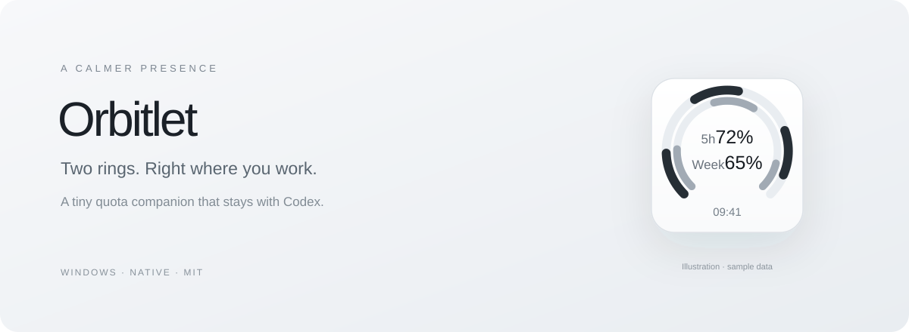

<p align="center"></p>

<p align="center">
  <a href="https://github.com/Chen99999999/codex-orbitlet/releases/latest">Download for Windows</a> ·
  <a href="README.zh-CN.md">简体中文</a> ·
  <a href="https://github.com/Chen99999999/codex-orbitlet/issues">Report an issue</a>
</p>

<p align="center">
  
  
  <a href="https://github.com/Chen99999999/codex-orbitlet/actions/workflows/windows.yml"></a>
</p>

# Orbitlet

**Two rings. A quieter way to watch your Codex quota.**

Orbitlet is a tiny native Windows companion that attaches to the Codex desktop window. It shows your remaining **5-hour** and **weekly** allowance, then gets out of the way when you leave Codex.

## Made to stay with Codex

- **Attached, not scattered across your desktop.** The widget stays inside Codex, follows its position and size, and hides when another app is active or Codex is minimized.
- **Small by design.** A 100 × 102 px standard view and an 88 × 90 px compact view. A white surface, centered text and two restrained arcs.
- **Real quota.** Reads the official Codex app-server's `account/rateLimits/read` method through your installed, signed-in CLI. Refreshes every 60 seconds.
- **Honest missing states.** Unknown quota is `--`, not `0%`. A failed refresh retains the last successful values and timestamp.
- **Optional automatic start.** A small per-user helper starts Orbitlet when Codex opens. No changes to the official app, its shortcuts or configuration.
- **No inference requests.** Monitoring does not start chats, send prompts or redeem quota resets.

> Independent community project. Orbitlet is not affiliated with, endorsed by, or an official product of OpenAI. Windows is the supported platform for this release.

## Get started

1. Download **Orbitlet-v0.5.0-windows.zip** from [Releases](https://github.com/Chen99999999/codex-orbitlet/releases/latest).
2. Extract the whole archive to a folder you plan to keep.
3. Make sure the official Codex app/CLI is installed and signed in with your ChatGPT account.
4. Open Codex, then run `Orbitlet.exe`.
5. Optional: run `Enable-Codex-Follow.cmd` once to enable automatic start with Codex.

No Node.js, Python, Electron or additional package installation is needed to run Orbitlet. It uses the Windows .NET Framework. The binary is currently unsigned.

The default mode is attached to Codex. If Codex is closed, minimized or in the background, the widget is intentionally hidden. For an independent desktop widget, exit the current instance and run `Launch-Standalone.cmd`.

If the CLI cannot be found, set `ORBITLET_CODEX_PATH` to the full path of your installed `codex.exe`. Orbitlet checks the desktop app's known runtime locations and executable entries on PATH; it does not bundle the CLI or install a new login.

## Controls

| Action | Behavior |
| --- | --- |
| Drag | Reposition inside Codex; the relative position is remembered |
| Double-click | Fold / unfold |
| Right-click | Window lock, compact size, refresh, auto-start and quit |
| F5 | Read quota now |
| Esc | Hide manually |
| Ctrl + Alt + O | Toggle visibility; attached mode still respects Codex focus |
| Tray icon | Show/hide, refresh or open the live browser preview |

Uncheck **锁定在 Codex 窗口** to detach the widget. The first release retains compact Chinese UI labels; the table above explains the controls. `本周` means the official rolling seven-day window, not the calendar week.

To stop automatic start, run `Disable-Codex-Follow.cmd` or uncheck **随 Codex 启动 / 关闭** in the context menu. If you move the extracted folder, disable auto-start in the old location before enabling it in the new one.

## How the numbers work

Orbitlet prefers `rateLimitsByLimitId.codex`, identifies the 300-minute and 10,080-minute windows by duration, and displays `100 - usedPercent`. It does not estimate quota from token counts or spending. API-key-only providers may not expose these subscription windows and are shown as unavailable.

The timestamp is the last successful upstream read. The optional browser preview reads the same in-memory snapshot from a loopback-only service; keep Orbitlet running while viewing it. Opening `web/preview.html` directly shows an offline state, never fake production quota.

Reference: [official app-server rate-limit protocol](https://learn.chatgpt.com/docs/app-server#6-rate-limits-chatgpt).

## Privacy

- Orbitlet delegates authentication to the installed Codex CLI. It does not open, copy or store your login tokens.
- No prompts, conversations or source files are read.
- No telemetry, advertising or third-party analytics are included.
- The local preview returns only normalized quota and sync information. It checks Host/Origin and does not enable CORS or arbitrary file access.
- Preferences and the optional Windows Startup shortcut stay on your computer. [Full privacy notes](PRIVACY.md).

## Build and test

On Windows with the .NET Framework compiler:

```powershell
powershell -NoProfile -File .\scripts\build.ps1
powershell -NoProfile -File .\scripts\test.ps1
```

The portable app is written to `dist/windows`. The 65 assertions cover quota mapping, unavailable values, desktop identity, CLI exclusion, focus visibility, docking and window bounds. Native integration tests create their own offscreen windows to check ownership, moving, resizing, minimizing, restoring and owner closure; foreground identity is simulated. Tests do not interact with Codex or need an account.

Stop the widget and follow helper before rebuilding a directory that is currently running, or pass `-OutputDirectory dist/dev` to the build script.

```powershell
powershell -NoProfile -File .\scripts\package.ps1
```

Builds and tests run on Windows in GitHub Actions. Real-account integration and window attachment have been checked on the maintainer's Windows machine; CI does not sign in or prove every desktop/DPI configuration.

## Scope and contributions

The goal is a small, calm quota companion. Contributions that improve reliability, accessibility, CLI discovery, localization and mixed-DPI behavior are welcome. See [CONTRIBUTING.md](CONTRIBUTING.md).

Please keep credentials and personal screenshots out of issues. For a possible vulnerability, see [SECURITY.md](SECURITY.md).

Licensed under [MIT](LICENSE).
